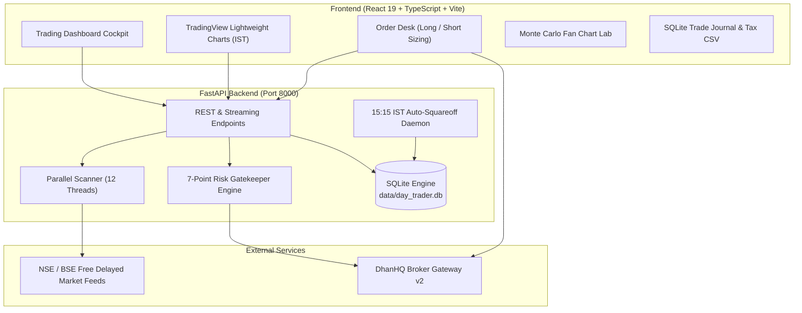

# Day Trader India 🇮🇳

### Visual Algorithmic Day-Trading Workstation & Execution Terminal for Indian Equities (NSE & BSE)

[](LICENSE)
[](https://python.org)
[](https://fastapi.tiangolo.com)
[](https://react.dev)
[](https://www.typescriptlang.org)
[](https://dhanhq.co)
[](https://www.nseindia.com)

---

**Day Trader India** is an open-source, full-stack visual algorithmic trading station designed from the ground up for Indian retail market traders. It bridges the gap between institutional-grade risk management and clean, reactive desktop UI—combining high-speed NSE chart plotting, Monte Carlo probability replays, pre-flight safety gatekeepers, and direct Dhan broker execution.

---

## 📸 Key Capabilities

### 1. TradingView Lightweight Charts Workstation
- **High-Performance Canvas**: Sub-second candle streaming powered by TradingView's Lightweight Charts engine.
- **Native IST Timezone**: Automatically accounts for Indian Standard Time (UTC+05:30) with zero canvas drift.
- **Visual Opening Range (09:15–09:30 AM IST)**: Displays on-chart shaded boundaries for OR High, OR Low, and OR Midpoint.
- **Interactive Bracket Price Lines**: Stop-Loss (Rose) and Target (Emerald) levels rendered directly on the price scale.
- **Candle Countdown Timer**: Live ticking countdown (`⏱ Bar: mm:ss`) displaying remaining time until the current 1m, 5m, or 15m candle closes.

### 2. High-Speed NSE F&O Parallel Scanner
- **Parallel Multi-Threaded Engine**: Scans liquid F&O stocks concurrently in ~1.5s with a 30-second memory cache.
- **Intraday Setup Detection**:
  - 15-Minute Opening Range Breakouts (**ORB Long**) & Breakdowns (**ORB Short**).
  - 20-Day High Breakouts & 20-Day Low Breakdowns.
  - Multi-bar Bull Flags & RSI(14) Oversold Mean-Reversion Bounces.
- **Conviction Scoring & Letter Grades**: Assigns quantifiable 0–100 scores and grades (`A+`, `A`, `B`, `C`) based on relative volume, trend momentum, and sector alignment.

### 3. 75-Bar Monte Carlo Time Machine
- **Historical Path Simulation**: Runs **10,000 simulated trading sessions** using the stock's actual 60-day historical 5-minute NSE bars before you risk a single rupee.
- **Statistical Fan Charts**: Plots 5th, 25th, 50th (median), 75th, and 95th price percentile projections for the remaining trading day.
- **Empirical Odds & Expected Value**: Calculates precise Target-First vs Stop-First probabilities and expected value in ₹ and R-multiples.

### 4. Dual Execution Engine (Paper Simulator & DhanHQ Live)
- **Safe Paper Trading by Default**: Full virtual capital simulation with realistic tick fills and zero account risk.
- **DhanHQ API v2 Integration**: 1-click execution for live intraday MIS bracket orders via Dhan's Trading APIs.
- **Intraday Short-Selling Support**: Full support for both **BUY (LONG)** and **SELL (SHORT)** setups with inverted bracket order mathematics.
- **Dynamic Risk Sizing**: Live slider or manual quantity input with real-time 5x MIS margin calculation.

### 5. Pre-Flight 7-Point Risk Gatekeeper
Every proposed trade must pass 7 automated risk barriers before reaching the broker:
1. **Stop Loss Orientation**: Verifies SL is strictly below entry for Longs, or strictly above entry for Shorts.
2. **Minimum 1.5 Reward:Risk**: Blocks poor R:R trades automatically.
3. **Max Risk Per Trade**: Enforces strict rupee loss ceilings (e.g. ₹1,000 max risk).
4. **Daily Cumulative Loss Limit**: Hard daily ceiling (default ₹3,000); once breached, all new entries are locked out.
5. **Entry Window Guard (09:30–14:30 IST)**: Prohibits fresh entries during opening whip-saws or post-2:30 PM decay.
6. **Circuit Breaker Protection**: Checks distance to Upper/Lower circuit limits.
7. **Broker Token & IP Check**: Ensures Dhan token is active and public IP matches the whitelist.

### 6. Mandatory 15:15 IST Auto-Squareoff Daemon
- Runs server-side in FastAPI independent of your browser tab.
- At **15:15:00 IST sharp**, all open day-trade positions are automatically flattened to protect you from broker penalty auto-squareoff charges (₹50 + GST).

### 7. SQLite Persistent Journal & CA Tax-Ready CSV Export
- Complete local database (`day_trader.db`) tracking all orders, active positions, and closed trades.
- Computes exact Indian statutory taxes under **Section 43(5) of the Income Tax Act**:
  - Securities Transaction Tax (**STT** @ 0.025% on sell leg).
  - Goods and Services Tax (**GST** @ 18% on brokerage + exchange charges).
  - Stamp Duty (@ 0.003% on buy leg) & SEBI turnover charges.
- **1-Click Export Tax CSV**: Generates formatted spreadsheets ready to hand directly to your Chartered Accountant for financial year-end speculative business tax returns.

---

## 🏗️ Architecture



---

## 🚀 Quickstart

### Option A: Docker Compose (Instant Containerized Deployment)

The easiest and most reliable way to launch Day Trader India is with Docker. Both the FastAPI backend and the Nginx-accelerated React frontend start with one command:

```bash
git clone https://github.com/<your-username>/day-trader-india.git
cd day-trader-india

# Launch platform in background
docker compose up -d --build
```

- **Web Terminal**: [http://localhost:5173](http://localhost:5173)
- **FastAPI Documentation**: [http://localhost:8000/docs](http://localhost:8000/docs)
- **Follow Logs**: `docker compose logs -f`
- **Stop Platform**: `docker compose down`

*Note: Your SQLite trade journal and credentials are mapped to `./backend/data` on your host machine, ensuring your data persists across container updates.*

---

### Option B: Local Bash Script (Direct Host Execution)

```bash
# Make startup script executable and launch
chmod +x run.sh
./run.sh
```

- **Frontend Dashboard**: [http://localhost:5173](http://localhost:5173)
- **Interactive API Documentation (Swagger)**: [http://localhost:8000/docs](http://localhost:8000/docs)

---

### Option C: Manual Setup

#### 1. Backend Setup (FastAPI)
```bash
cd backend
python3 -m venv venv
source venv/bin/activate  # On Windows: venv\Scripts\activate
pip install -r requirements.txt

# Start backend
uvicorn app.main:app --host 127.0.0.1 --port 8000 --reload
```

#### 2. Frontend Setup (React + Vite)
```bash
cd frontend
npm install
npm run dev
```

---

## ⚙️ Configuration & Dhan API Setup

1. Copy the example configuration:
   ```bash
   cp .env.example .env
   ```
2. **Paper Trading (Default)**: No credentials required! The app launches in safe paper trading mode out of the box.
3. **Connecting Live Dhan Account**:
   - Log into [Dhan Web](https://web.dhan.co).
   - Navigate to **DhanHQ & APIs** and copy your **Client ID** and **Access Token**.
   - In the web terminal's top header, click **DHAN (CONFIG)** and paste your credentials.
   - Whitelist your public IP address on Dhan Web if using IP-restricted tokens.
   - Toggle to **LIVE CAPITAL** when ready.

---

## 📊 Indian Statutory Charges Breakdown (MIS Equities)

The platform calculates friction on every trade before execution and upon square-off:

| Tax / Charge | Regulatory Rate | Applied Leg |
| :--- | :--- | :--- |
| **Brokerage** | Flat ₹20 per executed order | Both Buy & Sell |
| **STT (Securities Transaction Tax)** | 0.025% | Sell Leg Only |
| **Exchange Transaction Fee (NSE)** | ~0.00345% | Both Legs |
| **GST** | 18% | On Brokerage + Exchange Fees |
| **SEBI Turnover Charges** | ₹10 per Crore (0.0001%) | Both Legs |
| **Stamp Duty** | 0.003% | Buy Leg Only |

---

## ⚠️ Disclaimer

> [!IMPORTANT]
> **Educational and Paper-Trading Use Only**: This software is an open-source development tool intended for research, algorithmic backtesting, and paper trading. It **does not constitute financial, investment, or legal advice** and is not registered with the Securities and Exchange Board of India (SEBI) as an investment advisor or research analyst. Trading in the Indian stock and derivatives market involves substantial risk of financial loss. The maintainers and contributors assume zero liability for any capital losses incurred through the use of this software. Always test thoroughly in simulation mode.

---

## 🤝 Contributing

Contributions are warmly welcomed! Please check out [CONTRIBUTING.md](CONTRIBUTING.md) for details on adding new broker adapters (Zerodha, Angel One, Fyers), new scanner setups, and submitting pull requests.

---

## 📄 License

Distributed under the **MIT License**. See [LICENSE](LICENSE) for more information.
